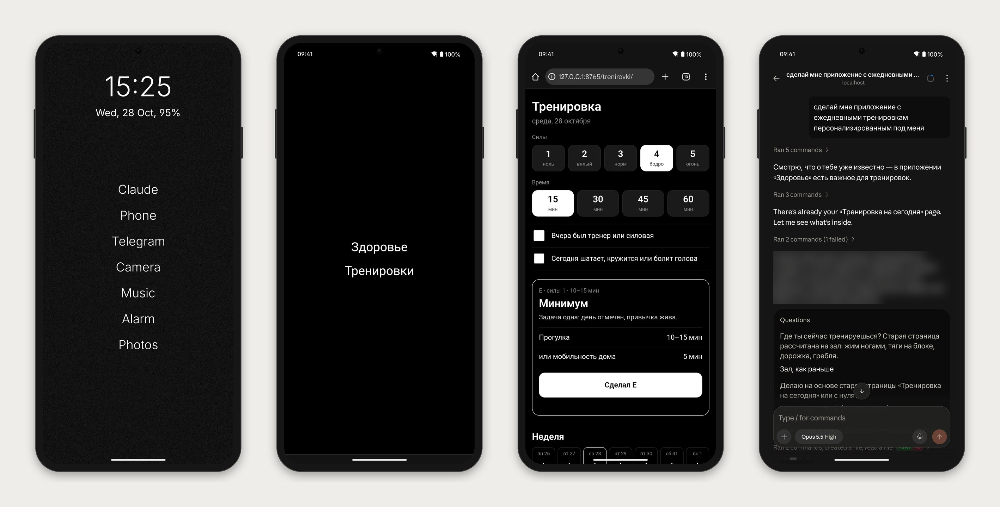

# trabun-skills

Открытая полка Даниэля Трабуна: скиллы для Claude Code, проекты и артефакты,
которыми можно поделиться. Берите, пробуйте, переделывайте под себя.

## Что где лежит

- `skills/` — скиллы для Claude Code. Каждый в своей папке, внутри `SKILL.md`.
- `projects/` — разборы проектов: задача, как делали, что получилось.
- `artifacts/` — готовые штуки: страницы, шаблоны, промпты, презентации.

## Скиллы

- [chat-names](skills/chat-names/SKILL.md) — новые чаты во вкладке Code сами получают название
  по формату `дд.мм | задача | проект` и сами ложатся в нужную группу сайдбара.
- [ai-phone-android](skills/ai-phone-android/SKILL.md) — AI-телефон из обычного Android: главный экран
  текстом, как у Light Phone, а внутри Claude Code, который сам управляет телефоном. Пишешь ему
  из приложения Claude, он собирает мини-приложения на второй экран.

  

- [family-history](skills/family-history/SKILL.md) — страница истории семьи с нуля: всё древо, карта
  переселений, главы по веткам. По фамилии, месту и вере выбирает архивы, сам ходит в них через браузер.
  Материалы проверяет, если они есть, а если их нет, начинает с разговора с родными и открытых баз.

- [viral-drafts](skills/viral-drafts/SKILL.md) — три черновика постов на вашу тему, которые будут пересылать,
  и десять запасных. Ищет в сети по четырём полкам того, что пересылают, проверяет первоисточник
  и то, что ваша аудитория этого ещё не видела, пишет вашим голосом и даёт пост читателю без контекста.
  На первом запуске рассказывает, как устроен, и за 10–15 минут настраивается под тему, площадку и голос.

## Как поставить скилл

Скопируйте папку скилла в `.claude/skills/` своего проекта
или в `~/.claude/skills/`, чтобы он работал везде.
Перезапустите сессию Claude Code — скилл появится в списке.

## Лицензия

MIT — см. [LICENSE](LICENSE).
