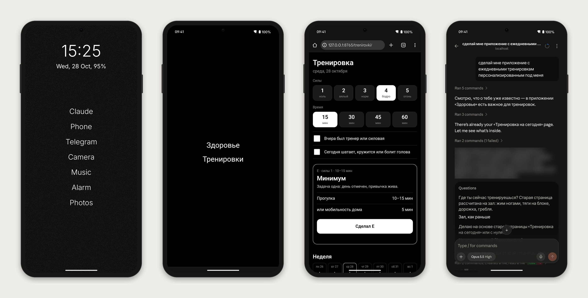

# AI-телефон на Android



Что получится:

- **Главный экран как у Light Phone** — чёрный фон, по центру пять-семь строк текста: Claude, Phone, Music…
  Лаунчер — [Olauncher](https://github.com/tanujnotes/Olauncher).
- **Claude Code прямо на телефоне** — в Termux, в фоне. Пишешь ему из приложения Claude (вкладка Code),
  он делает скриншоты, читает экран, нажимает, печатает, открывает приложения и ссылки.
- **Мини-приложения** — «сделай мне трекер воды» → Claude собирает веб-приложение в один HTML-файл,
  оно появляется на странице «Мои приложения» (свайп вправо) и открывается в Chrome.
- **Своя база, если есть** — репозиторий пользователя с его `CLAUDE.md` клонируется на телефон,
  Claude стартует в нём и при каждом запуске делает `git pull`.

Ставишь всё ты, с компьютера, по шагам ниже. Пользователь нужен там, где вход в аккаунты, коды
и разрешения Android — эти места помечены **[сам]**: такие действия не делай за него.

## Что нужно

- Android 8+ на arm64 (`adb shell getprop ro.product.cpu.abi` → `arm64-v8a`), Wi-Fi.
- Компьютер с Claude Code и `adb` (`brew install --cask android-platform-tools` на Mac).
- Подписка Claude Pro или Max: Remote Control с API-ключом не работает.
- Google-аккаунт на телефоне в порядке: Play Store открывается без «Authentication is required».

## Как командовать телефоном с компьютера

Termux ставь **с GitHub** (debug-сборка): она разрешает `run-as com.termux`, и ты выполняешь команды
внутри Termux прямо из `adb shell`, не печатая на телефоне. Заведи себе обёртку:

```bash
T=/data/data/com.termux/files
tx() { adb shell "run-as com.termux $T/usr/bin/env PREFIX=$T/usr HOME=$T/home PATH=$T/usr/bin:$T/home/.local/bin TMPDIR=$T/usr/tmp LANG=en_US.UTF-8 LD_PRELOAD=$T/usr/lib/libtermux-exec.so bash --norc -c '$1'"; }
```

Файлы передавай так: `adb push файл /data/local/tmp/` → `tx 'cp /data/local/tmp/файл ~/…'`.
Экран читай через `adb shell uiautomator dump` (дерево элементов) и `adb exec-out screencap -p` (скриншот).
Если пользователь сказал что-то про USB или зарядку — проверь `ioreg`/`lsusb`: многие провода рвут
данные через секунды, тогда сразу переходи на беспроводную отладку (шаг 1).

## Установка

1. **Связь.** **[сам]** Settings → About phone → 7 раз по Build number; Developer options → USB debugging
   и Wireless debugging → включить → «Pair device with pairing code». Пользователь называет 6 цифр;
   порт найди сам: `adb mdns services` (`_adb-tls-pairing`). `adb pair IP:порт код`, потом
   `adb connect` на порт `_adb-tls-connect`. Первая попытка `pair` часто падает с protocol fault — повтори.
2. **Приложения** — скачай с GitHub-релизов и сверь суммы (`gh release download`):
   `termux/termux-app` (arm64-v8a), `termux/termux-api`, `termux/termux-boot`, `tanujnotes/Olauncher`.
   Все Termux-приложения — из одного источника, иначе подписи не совпадут. `adb install -r` каждое.
   F-Droid-клиент не ставь: обновлять GitHub-сборки он не сможет.
3. **Главный экран.** `adb shell cmd role add-role-holder android.app.role.HOME app.olauncher 0`.
   Настрой Olauncher руками через экран (долгое нажатие по пустому месту → настройки):
   Apps on home screen — сколько строк, App alignment — Center, Text size — максимум.
   Строки — долгое нажатие по «App» → выбрать приложение; переименовать строку — в том же окне
   набрать название и нажать **RENAME** (переименование в общем списке на главный экран не попадает).
   Чёрные обои: собери чёрный PNG под `wm size`, положи в `/sdcard/Pictures`, просканируй
   (`am broadcast -a android.intent.action.MEDIA_SCANNER_SCAN_FILE`) и открой
   `am start -a android.intent.action.ATTACH_DATA -d content://media/external/images/media/<id> -t image/png` → Wallpaper.
   Спроси пользователя, какие приложения поставить строками; по умолчанию — Claude, Phone, мессенджер,
   Camera, Music, Alarm, Photos.
4. **Termux.** Запусти его один раз (`am start -n com.termux/.app.TermuxActivity`) и дождись базы
   (`$PREFIX/bin` заполнен). Проверь интернет изнутри: `tx 'curl -sI https://packages-cf.termux.dev | head -1'`.
   Нет ответа — почти всегда VPN-приложение на телефоне режет трафик Termux: **[сам]** выключить
   или добавить Termux в исключения.
5. **Claude Code.** Официальной сборки под Android нет; работает установщик сообщества
   [awesome-termux/claude-code-android](https://github.com/awesome-termux/claude-code-android): берёт официальный
   linux-arm64 бинарник с `downloads.claude.ai`, сверяет сумму с манифестом и подправляет через glibc-runner.
   **Прочитай `install.sh` целиком и покажи пользователю, что он делает, до запуска.** Запускай в самом
   Termux, не через `run-as`: положи скрипт в `~` и набери на телефоне `adb shell input text 'bash\ ~/install.sh'`
   + `KEYCODE_ENTER`, ответы на два вопроса — `y`. Лог в файл, жди `claude --version`. На время установки —
   `adb shell svc power stayon true`, в конце верни `false`.
6. **Пакеты:** `tx 'apt-get install -y android-tools nmap tmux'`.
7. **Руки и запуск.** Скопируй `phone/bin/*` в `~/.local/bin/` (chmod 700), `phone/boot/start-claude` —
   в `~/.termux/boot/`, допиши `phone/bashrc-add` в конец `~/.bashrc`. Рабочая папка — `~/phone`
   или клон базы (шаг 10); путь положи в `~/.ph-workdir`. Шаблон `phone/CLAUDE.phone.md` заполни
   (модель, Android, `wm size`) и положи как `CLAUDE.md` в `~/phone` — или как `CLAUDE.local.md` в клон базы
   с записью в `.git/info/exclude`. Правка `.bashrc` и автозапуск — спроси пользователя прямо.
8. **Руки на самого себя.** Termux должен ходить в adb телефона. Открой Wireless debugging →
   Pair with pairing code, прочитай код и порт с экрана через `uiautomator dump`, выполни
   `tx 'adb pair 127.0.0.1:<порт> <код>'`. Проверь: `tx 'ph-connect && ph getprop ro.product.model && ph-shot'`.
   Потом `tx 'adb kill-server'` — сервер adb, поднятый через `run-as`, мешает самому Termux.
9. **Вход и Remote Control.** Убей Termux (`am force-stop com.termux`) и открой заново — `.bashrc` поднимет
   tmux-сессию `claude`. Пройди тему и выбор входа клавишами (`tx 'tmux send-keys -t claude Enter'`).
   Ссылку для входа бери целиком: `tmux capture-pane -p -t claude -S -60`, склей строки от `https://` до
   `Paste code` — обрезанная ссылка даёт «Invalid OAuth request». Открой её в Chrome телефона.
   **[сам]** Войти, Authorize, скопировать код, вставить в Termux, набрать `/exit`. Дальше в tmux
   стартует `claude remote-control`: на «Trust this folder?» и «Enable Remote Control?» — `y`, spawn mode — `1`.
   **[сам]** Поставить приложение Claude из Play Store, войти тем же аккаунтом, разрешить уведомления;
   разрешить Termux работать в фоне (Android спросит сам после `termux-wake-lock`); один раз открыть Termux:Boot.
   Строку Claude на главном экране свяжи с приложением Claude, свайп влево — с Termux.
10. **База пользователя (по желанию).** Есть репозиторий с `CLAUDE.md` — **[сам]** `gh auth login -w` через
    одноразовый код на github.com/login/device (запусти в tmux, код прочитай из лога). Настрой helper:
    `git config --global credential.https://github.com.helper '!$PREFIX/bin/gh auth git-credential'`
    (`gh auth setup-git` под `run-as` ломается). Клонируй, впиши путь в `~/.ph-workdir`, перезапусти
    сессию `claude`. Скажи пользователю: теперь в `main` пушат два устройства — на компьютере перед `push`
    нужен `git pull --rebase --autostash`.
11. **Мини-приложения.** `tx 'ph-apps-server'` → открой `http://127.0.0.1:8765/home/` в Chrome → меню ⋮ →
    Add to home screen → Install. Должен появиться пакет `org.chromium.webapk.*` (`pm list packages | grep webapk`);
    вместо него вышел ярлык — переустанови. Повесь «Мои приложения» на свайп вправо в Olauncher.
12. **Разрешения** — с согласия пользователя слей `phone/permissions.json` в `~/.claude/settings.json`
    на телефоне (`jq -s '.[0] * .[1]'`): иначе Claude спрашивает «можно?» на каждое нажатие по экрану.
13. **Проверка.** Пользователь пишет из приложения: «открой Chrome». Дальше — «сделай приложение с таймером».
    Свайп вправо → оно в списке → открывается в Chrome → снова свайп → снова список.

## Грабли из практики

- **Старая сессия молчит.** Перезапустил `remote-control` в другой папке — старая сессия в приложении
  осталась, но за ней никого нет. Скажи пользователю писать в сессию с зелёной точкой.
- **Первая сессия после переезда** стартовала 80+ секунд, следующие — за секунды. Для диагноза:
  `claude remote-control --debug --debug-file ~/rc-debug.log` — пишет лог и по каждой сессии.
- **tmux-сервер, поднятый через `run-as`, ломает запуск claude** (`unexpected e_type: 2`). Первым его должен
  поднять сам Termux. Пока жива сессия `apps`, сессию `claude` можно убивать и создавать заново через `tx`.
- **`bash` над adb читает `.bashrc`** даже в неинтерактивном режиме — блок автозапуска проверяет `$-` и `-t 0`.
- **Порт беспроводной отладки меняется** при каждом включении. `ph-connect` ищет его `nmap`'ом и даёт каждому
  порту 3 секунды — без таймаута `adb connect` на чужих портах висел ~50 с.
- **Кириллицу `input text` не печатает** — `ph-type` идёт через буфер Termux:API и `KEYCODE_PASTE`.
- **`uiautomator dump` ~2,5 с**, скриншот ~0,7 с: задача в десять нажатий — минута-две. Это нормально.
- **WebAPK держит всё в своей задаче**: ссылки, `target=_blank` и `intent://` из «Моих приложений» открываются
  внутри него, и свайп возвращает в последнее приложение. Поэтому список зовёт `/open/<slug>` на своём сервере,
  а тот открывает Chrome через adb. Без отладки приложение откроется поверх списка, с крестиком.
- **Список не обновлялся** между свайпами — страница перечитывает себя на `visibilitychange`.
- **Переустановка WebAPK** после удаления иногда даёт ярлык вместо приложения — помогает поле `id` в манифесте.
- **Свайпы по поиску Olauncher** печатают текст клавиатурой — сначала спрячь клавиатуру (`KEYCODE_BACK`).
- **Автопроверка Claude Code** на компьютере останавливает запуск стороннего установщика, правку `.bashrc`
  и запись разрешений агента — на каждый из этих шагов нужно прямое «да» пользователя.

## Чего здесь нет

- Браузер Claude водит через экран, без DevTools: медленнее, зато работает с любым сайтом.
- Беспроводная отладка живёт только на Wi-Fi. Без Wi-Fi Claude отвечает в чате, но экран не трогает.
- Установщик Claude Code — сообщества, не Anthropic: после очередного обновления может сломаться, тогда
  запасной путь из его README — Ubuntu в `proot-distro` и официальный установщик.
